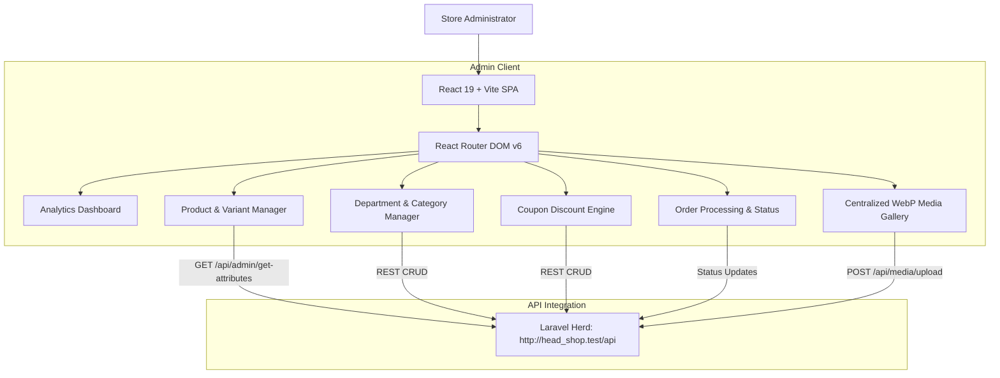

# 🎛️ Herd Shop — Modern React Admin Dashboard

> **Enterprise-grade Single Page Application (SPA)** built with React 19, Vite, and Tailwind CSS for apparel catalog control, inventory management, dynamic coupon engines, order processing, and media management.

---

## 🏗️ Architecture & Flowchart



---

## 🛠️ Technology Stack

| Layer | Technology | Details |
|---|---|---|
| **Core Framework** | React 19 | Fast declarative UI components |
| **Build Tool** | Vite 6 | Lightning-fast HMR & optimized Rollup bundles |
| **Styling** | Tailwind CSS v3 | Utility-first responsive design & custom theme |
| **Icons** | Lucide React & React Icons (Fi) | Clean, lightweight SVG vector icons |
| **Animations** | Framer Motion | Smooth modal transitions, tabs, and notifications |
| **HTTP Client** | Axios | Interceptors with Bearer JWT tokens & auto-refresh |
| **Backend Integration** | Laravel Herd | Direct communication with `http://head_shop.test/api` |

---

## ✨ Key Capabilities

### 1. 100% Dynamic Attribute-Driven Cataloging
- **No Hardcoded Options**: Categories, Departments, Sizes, Colors, and Fit types are loaded dynamically via `/api/admin/get-attributes`.
- **Apparel Specialization**:
  - Department classification (`men`, `women`, `kids`, `baby`, `unisex`).
  - Interactive Size Chart selector for garments.
  - Multi-variant matrix (Color hex picker + Size pills + SKU + Stock count).
  - Garment fabric specs (GSM, Composition, Care instructions).

### 2. Coupon & Promotion Engine (`AdminCoupons.jsx`)
- Create percentage, fixed amount, and free shipping discount codes.
- Set minimum purchase limits, maximum discount caps, and usage quotas.
- 1-Click modal to toggle active/inactive status without page reload.

### 3. Order Management & Delivery Tracking
- Real-time customer order pipeline (`pending`, `processing`, `shipped`, `delivered`, `cancelled`).
- Order item breakdown showing selected size, color, customer phone, and dynamic delivery zone.

### 4. Centralized WebP Media Uploader
- Uploads images directly to `/api/media/upload`.
- Instant preview of WebP responsive sizes (`thumbnail`, `medium 3:4`, `large`).

---

## 🚀 Getting Started & Local Setup

### Prerequisites
- Node.js (v18 or higher)
- npm / pnpm / yarn
- Laravel Herd running the backend at `http://head_shop.test`

### Installation Steps

1. **Navigate to the Admin directory:**
   ```bash
   cd head_shop/admin_ui
   ```

2. **Install Dependencies:**
   ```bash
   npm install
   ```

3. **Configure Environment:**
   Create or verify `.env`:
   ```env
   VITE_API_BASE_URL=http://head_shop.test/api
   VITE_USE_API=true
   VITE_APP_THEME=standard
   ```

4. **Start Vite Development Server:**
   ```bash
   npm run dev
   ```
   *Dashboard will be available at: `http://localhost:5173`*

5. **Build for Production:**
   ```bash
   npm run build
   ```
   *Outputs optimized production bundle into `dist/` directory in ~12 seconds.*

---

## 📁 Project Directory Structure

```text
admin_ui/
├── public/                 # Static assets & brand icons
├── src/
│   ├── components/         # Reusable UI widgets
│   │   ├── admin/          # Admin-specific tables, sortable headers, stat cards
│   │   └── common/         # Modals, Pagination, Buttons, Form inputs
│   ├── pages/
│   │   └── admin/
│   │       ├── AdminDashboard.jsx    # Revenue & KPI analytics
│   │       ├── AdminProducts.jsx     # Garment & variant manager
│   │       ├── AdminCategories.jsx   # Department & category CRUD
│   │       ├── AdminCoupons.jsx      # Discount engine CRUD
│   │       ├── AdminOrders.jsx       # Order lifecycle & fulfillment
│   │       └── AdminSettings.jsx     # Site configs & WhatsApp number
│   ├── routes/             # AppRoutes.jsx with protected route guards
│   ├── services/           # api.js with Axios interceptors
│   └── styles/             # Tailwind & CSS custom utility layers
├── index.html
├── package.json
└── vite.config.js
```

---

## 👨‍💻 Developer & Author Credit

Developed & Maintained by:
- **Developer:** **Sakhawat Hossain**
- **GitHub Username:** [@sajusun](https://github.com/sajusun)
- **Profile:** [https://github.com/sajusun](https://github.com/sajusun)

---
*© 2026 Herd Shop Admin UI. High-Performance React Dashboard.*
